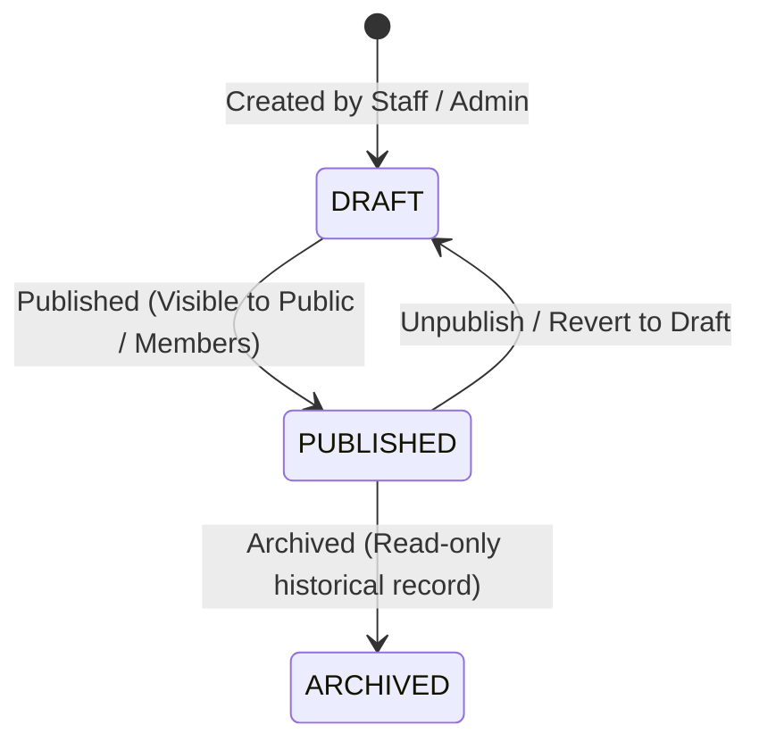

# WaanOfii — Organization CMS & Public Content Architecture

## 1. Overview & Purpose

The Organization Content Management System (CMS) enables tenants to manage their public-facing organization profile, leadership directory, programs, membership benefits, rules/bylaws, and announcements.

Crucially, all CMS components:
1. Are strictly isolated per tenant via `organization_id` foreign keys and PostgreSQL Row-Level Security (RLS).
2. Incorporate strict Cross-Site Scripting (XSS) input sanitization and rejection.
3. Support lifecycle state management for programs and announcements (`DRAFT`, `PUBLISHED`, `ARCHIVED`).
4. Provide both authenticated administrative endpoints and public read-only views for prospective members and the public.

---

## 2. Domain Entities

The CMS domain is backed by six dedicated relational entities in PostgreSQL:

1. **`OrganizationProfile`**: Extended biographical, mission, vision, history, and social link metadata for an organization.
2. **`LeadershipPosition`**: Defined roles within the organization structure (e.g., "President", "Secretary", "Treasurer") with order index and terms.
3. **`Leader`**: Individuals occupying leadership positions, including name, bio, image, tenure dates, and active flags.
4. **`OrganizationProgram`**: Initiatives, projects, or charitable activities organized by the tenant. Governed by status (`DRAFT`, `PUBLISHED`, `ARCHIVED`).
5. **`MembershipBenefit`**: Concrete perks and privileges tied to membership within the tenant.
6. **`OrganizationRule`**: Governance rules, bylaws, and constitutional articles with section numbering and ordering.
7. **`OrganizationAnnouncement`**: Official news, releases, and urgent updates with publication lifecycle and target audiences.

---

## 3. Strict Input Sanitization & Anti-XSS Engine

To protect against persistent and stored XSS attacks, all text content ingested by the CMS endpoints passes through `sanitizeContentValue`:

```typescript
export function sanitizeContentValue(input: string): string {
  if (!input || typeof input !== 'string') return input;

  // Strict rejection of active executable HTML/JS payloads
  const dangerousPatterns = [
    /<script\b[^<]*(?:(?!<\/script>)<[^<]*)*<\/script>/gi,
    /javascript:/gi,
    /onerror\s*=/gi,
    /onload\s*=/gi,
    /onclick\s*=/gi,
    /<iframe/gi,
  ];

  for (const pattern of dangerousPatterns) {
    if (pattern.test(input)) {
      throw new BadRequestException('Content contains disallowed script or event handler elements.');
    }
  }

  // Strip remaining HTML tags
  return input.replace(/<[^>]*>/g, '').trim();
}
```

### 3.1 Security Principles
- **Early Rejection**: If malicious patterns (`<script>`, `onerror=`, `javascript:`, `<iframe`) are detected, the API rejects the request immediately with `HTTP 400 Bad Request` rather than silently mangling input.
- **Tag Stripping**: Benign HTML tags are stripped down to clean plain text.
- **Audit Logging**: Any administrative changes to rules or organizational profiles are captured in `audit_logs`.

---

## 4. Lifecycle Transitions

Programs and Announcements follow a rigorous lifecycle model:



- **DRAFT**: Visible only to authenticated tenant staff and administrators.
- **PUBLISHED**: Visible to the public via `/api/v1/org/:slug` or `/api/v1/cms/**` public endpoints.
- **ARCHIVED**: Kept for historical compliance and records; no longer featured on active feeds.

---

## 5. Security & Isolation Matrix

| Action | Required Role / Permission | RLS Enforcement |
|---|---|---|
| **View Published Profile / CMS** | Public (`@AllowProspectiveMember()` or Public Route) | Scoped by requested tenant `slug` or `id` |
| **Manage Profile / Settings** | `tenant:settings:manage` | Scoped by `organization_id` session |
| **Create / Update Leadership** | `tenant:settings:manage` | Scoped by `organization_id` session |
| **Publish Programs / Announcements**| `tenant:settings:manage` | Scoped by `organization_id` session |
| **Cross-Tenant Mutation Attack** | Any | **Blocked by RLS & Tenant Boundary (403/404)** |
