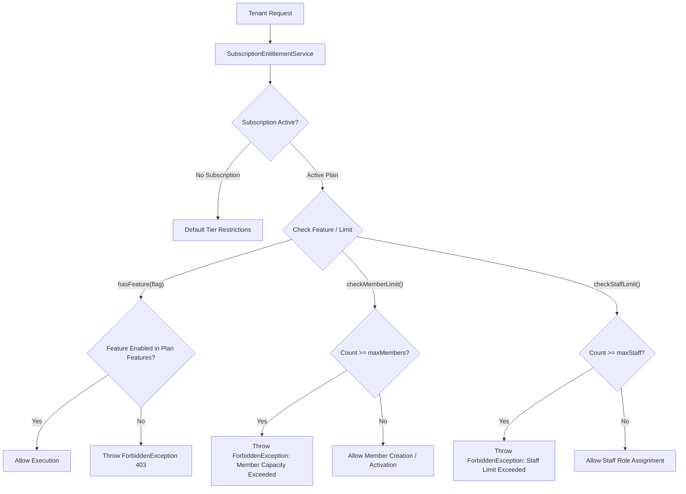

# WaanOfii — SaaS Plans & Entitlement Enforcement Architecture

## 1. Overview & Purpose

WaanOfii monetizes tenant organizations through tiered SaaS subscription plans. Entitlement enforcement guarantees that organizations operate strictly within their subscribed tier limits for:
1. Active member capacity (`maxMembers`)
2. Staff seat count (`maxStaff`)
3. Feature flags (e.g., `customBranding`, `advancedAnalytics`, `customRoles`, `apiAccess`)

---

## 2. Entitlement Architecture



---

## 3. Entitlement Service Interface

Implemented in `src/subscriptions/subscription-entitlement.service.ts`:

### 3.1 Feature Assertions
```typescript
// Non-blocking query
async hasFeature(orgId: string, featureCode: string): Promise<boolean>

// Strict gateway assertion
async assertFeature(orgId: string, featureCode: string): Promise<void>
```
If `assertFeature` fails, it throws a `ForbiddenException`:
`Feature '${featureCode}' is not included in your current subscription tier.`

### 3.2 Capacity Checking
```typescript
// Capacity assertions
async checkMemberLimit(orgId: string): Promise<void>
async checkStaffLimit(orgId: string): Promise<void>

// Metric aggregation
async getUsageMetrics(orgId: string): Promise<UsageMetricsDto>
```

### 3.3 Usage Metrics Output
The `GET /api/v1/subscriptions/usage` endpoint reports operational consumption metrics:
```json
{
  "currentMembers": 42,
  "maxMembers": 1000,
  "memberCapacityPercent": 4.2,
  "currentStaff": 3,
  "maxStaff": 10,
  "planCode": "PRO",
  "planName": "Professional Tier",
  "features": {
    "customBranding": true,
    "advancedAnalytics": true,
    "apiAccess": false
  }
}
```

---

## 4. Platform Admin vs. Tenant Admin Capabilities

- **Platform Super Admin**:
  - Creates, updates, and deletes SaaS plans (`POST /api/v1/admin/plans`).
  - Assigns and upgrades tenant subscriptions (`POST /api/v1/admin/subscriptions/assign`).
  - Sets custom plan feature flags and quotas.
- **Tenant Administrator**:
  - Views subscribed plan details (`GET /api/v1/subscriptions/me`).
  - Inspects real-time usage metrics and capacity limits (`GET /api/v1/subscriptions/usage`).
  - Submits upgrade requests.
  - Cannot alter plan configurations, feature flags, or seat caps.
