# WAANOFII ENTITY RELATIONSHIP DIAGRAM (ERD) & DATA DICTIONARY
## Phase 2: Schema Blueprint & Relational Specifications

---

## 1. COMPREHENSIVE MERMAID ENTITY RELATIONSHIP DIAGRAM

```mermaid
erDiagram
    ORGANIZATION ||--o{ ORGANIZATION_DOMAIN : "owns"
    ORGANIZATION ||--o| ORGANIZATION_SUBSCRIPTION : "subscribes_via"
    ORGANIZATION ||--o| ORGANIZATION_PROFILE : "described_by"
    ORGANIZATION ||--o{ STAFF_MEMBERSHIP : "employs"
    ORGANIZATION ||--o{ ROLE : "defines"
    ORGANIZATION ||--o{ MEMBER_PROFILE : "enrolls"
    ORGANIZATION ||--o{ MEMBERSHIP_PLAN : "offers"
    ORGANIZATION ||--o{ MEMBERSHIP : "contracts"
    ORGANIZATION ||--o{ MEMBERSHIP_PERIOD : "tracks_terms"
    ORGANIZATION ||--o{ PAYMENT_METHOD : "configures"
    ORGANIZATION ||--o{ PAYMENT : "collects"
    ORGANIZATION ||--o{ PAYMENT_PROOF : "stores_receipts"
    ORGANIZATION ||--o{ PAYMENT_REVIEW : "audits_payments"
    ORGANIZATION ||--o{ PAYMENT_TRANSACTION : "logs_gateway"
    ORGANIZATION ||--o{ DIGITAL_MEMBERSHIP_CARD : "issues"
    ORGANIZATION ||--o{ VERIFICATION_TOKEN : "signs"
    ORGANIZATION ||--o{ VERIFICATION_LOG : "audits_scans"
    ORGANIZATION ||--o{ LEADERSHIP_POSITION : "defines_ranks"
    ORGANIZATION ||--o{ LEADER : "governed_by"
    ORGANIZATION ||--o{ PROGRAM : "conducts"
    ORGANIZATION ||--o{ BENEFIT : "provides"
    ORGANIZATION ||--o{ RULE : "enforces"
    ORGANIZATION ||--o{ ANNOUNCEMENT : "broadcasts"
    ORGANIZATION ||--o{ NOTIFICATION : "dispatches"
    ORGANIZATION ||--o{ NOTIFICATION_PREFERENCE : "configures"
    ORGANIZATION ||--o{ AUDIT_LOG : "records"

    SAAS_PLAN ||--o{ ORGANIZATION_SUBSCRIPTION : "defines_tier"

    USER ||--o{ SESSION : "authenticates_via"
    USER ||--o{ STAFF_MEMBERSHIP : "assigned_staff_role"
    USER ||--o{ MEMBER_PROFILE : "holds_constituent_profile"
    USER ||--o{ NOTIFICATION : "receives"
    USER ||--o{ NOTIFICATION_PREFERENCE : "sets_preferences"
    USER ||--o{ AUDIT_LOG : "acts_in"
    USER ||--o{ PAYMENT_REVIEW : "conducts_review"

    ROLE ||--o{ ROLE_PERMISSION : "contains"
    PERMISSION ||--o{ ROLE_PERMISSION : "granted_to"
    ROLE ||--o{ STAFF_MEMBERSHIP : "categorizes"

    MEMBER_PROFILE ||--o{ MEMBERSHIP : "enrolls_in"
    MEMBERSHIP_PLAN ||--o{ MEMBERSHIP : "governs"
    MEMBERSHIP ||--o{ MEMBERSHIP_PERIOD : "divided_into"
    MEMBERSHIP ||--o{ PAYMENT : "invoiced_under"
    PAYMENT_METHOD ||--o{ PAYMENT : "processed_through"
    PAYMENT ||--o{ PAYMENT_PROOF : "substantiated_by"
    PAYMENT ||--o{ PAYMENT_REVIEW : "evaluated_by"
    PAYMENT ||--o{ PAYMENT_TRANSACTION : "recorded_via"

    MEMBERSHIP ||--o| DIGITAL_MEMBERSHIP_CARD : "produces_credential"
    DIGITAL_MEMBERSHIP_CARD ||--o| VERIFICATION_TOKEN : "verified_via"
    DIGITAL_MEMBERSHIP_CARD ||--o{ VERIFICATION_LOG : "scanned_in"

    LEADERSHIP_POSITION ||--o{ LEADER : "held_by"
```

---

## 2. CORE DOMAIN DATA DICTIONARY

### 2.1 Platform & Tenancy Domain

#### Table: `organizations`
Represents an isolated tenant organization on the SaaS platform (e.g., 4B Association).

| Column | Type | Constraints | Description |
| :--- | :--- | :--- | :--- |
| `id` | `UUID` | `PK, @default(uuid())` | Unique tenant identifier. |
| `name` | `TEXT` | `NOT NULL` | Legal name of organization. |
| `slug` | `TEXT` | `UNIQUE, NOT NULL` | Subdomain slug (e.g. `4b`). |
| `status` | `ENUM` | `NOT NULL, DEFAULT 'ONBOARDING'` | `ONBOARDING`, `PENDING_APPROVAL`, `ACTIVE`, `GRACE_PERIOD`, `SUSPENDED`, `DEACTIVATED`. |
| `logo_url` | `TEXT` | `NULLABLE` | S3 path to logo asset. |
| `cover_image_url` | `TEXT` | `NULLABLE` | S3 path to cover banner. |
| `contact_email` | `TEXT` | `NOT NULL` | Official contact email. |
| `contact_phone` | `TEXT` | `NULLABLE` | Official contact telephone. |
| `address` | `TEXT` | `NULLABLE` | Physical office location. |
| `timezone` | `TEXT` | `NOT NULL, DEFAULT 'Africa/Addis_Ababa'` | Local operational timezone. |
| `default_language` | `TEXT` | `NOT NULL, DEFAULT 'am'` | Default portal language (`am` or `en`). |
| `supported_languages`| `TEXT[]`| `DEFAULT ['en', 'am']` | Array of enabled languages. |
| `currency` | `TEXT` | `NOT NULL, DEFAULT 'ETB'` | Primary operating currency. |
| `created_at` | `TIMESTAMPTZ` | `NOT NULL, DEFAULT now()` | Tenant creation timestamp. |
| `updated_at` | `TIMESTAMPTZ` | `NOT NULL` | Auto-updated timestamp. |
| `deleted_at` | `TIMESTAMPTZ` | `NULLABLE` | Soft deletion / archival timestamp. |

---

### 2.2 Identity & Access Management (IAM)

#### Table: `users`
Represents a global human identity across all tenant organizations.

| Column | Type | Constraints | Description |
| :--- | :--- | :--- | :--- |
| `id` | `UUID` | `PK, @default(uuid())` | Global user identifier. |
| `email` | `TEXT` | `UNIQUE, NULLABLE` | Optional login email. |
| `phone_number` | `TEXT` | `UNIQUE, NULLABLE` | Optional login mobile phone number. |
| `password_hash` | `TEXT` | `NOT NULL` | Argon2id cryptographically hashed password. |
| `first_name` | `TEXT` | `NOT NULL` | Legal given name. |
| `last_name` | `TEXT` | `NOT NULL` | Legal family/father name. |
| `is_platform_admin` | `BOOLEAN` | `NOT NULL, DEFAULT false` | SaaS Super Administrator flag. |
| `status` | `ENUM` | `NOT NULL, DEFAULT 'ACTIVE'` | `PENDING_VERIFICATION`, `ACTIVE`, `SUSPENDED`, `DEACTIVATED`. |
| `email_verified_at` | `TIMESTAMPTZ` | `NULLABLE` | Timestamp of email verification. |
| `phone_verified_at` | `TIMESTAMPTZ` | `NULLABLE` | Timestamp of SMS OTP phone verification. |
| `created_at` | `TIMESTAMPTZ` | `NOT NULL, DEFAULT now()` | Account creation date. |
| `updated_at` | `TIMESTAMPTZ` | `NOT NULL` | Account update date. |
| *Check Constraint* | `check_user_has_auth_identifier` | `CHECK (email IS NOT NULL OR phone_number IS NOT NULL)` | Enforces at least one contact/login identifier. |
| *Functional Index* | `users_email_lower_unique` | `CREATE UNIQUE INDEX ... (LOWER(email)) WHERE email IS NOT NULL` | Prevents duplicate user accounts via case variations. |

#### Table: `staff_memberships`
Associates a global `User` with an administrative `Role` in a specific `Organization`.

| Column | Type | Constraints | Description |
| :--- | :--- | :--- | :--- |
| `id` | `UUID` | `PK, @default(uuid())` | Primary key. |
| `organization_id` | `UUID` | `FK -> organizations.id, ON DELETE CASCADE` | Tenant owner. |
| `user_id` | `UUID` | `FK -> users.id, ON DELETE CASCADE` | Assigned staff user. |
| `role_id` | `UUID` | `FK -> roles.id, ON DELETE RESTRICT` | Assigned operational role. |
| `is_active` | `BOOLEAN` | `NOT NULL, DEFAULT true` | Active flag. |
| `created_at` | `TIMESTAMPTZ` | `NOT NULL, DEFAULT now()` | Role grant date. |
| `updated_at` | `TIMESTAMPTZ` | `NOT NULL` | Update date. |
| *Composite Unique* | `(organization_id, user_id)` | `UNIQUE` | User has exactly one staff role per tenant. |

---

### 2.3 Member & Membership Domain

#### Table: `member_profiles`
Represents a constituent individual enrolled in a specific association.

| Column | Type | Constraints | Description |
| :--- | :--- | :--- | :--- |
| `id` | `UUID` | `PK, @default(uuid())` | Member profile identifier. |
| `organization_id` | `UUID` | `FK -> organizations.id, ON DELETE CASCADE` | Tenant owner. |
| `user_id` | `UUID` | `FK -> users.id, ON DELETE CASCADE` | Linked global user identity. |
| `member_number` | `TEXT` | `NOT NULL` | Tenant-scoped member code (e.g. `4B-2026-00101`). |
| `first_name` | `TEXT` | `NOT NULL` | Member legal first name. |
| `last_name` | `TEXT` | `NOT NULL` | Member legal last name. |
| `photo_url` | `TEXT` | `NULLABLE` | High-res portrait photo URL for digital ID card. |
| `national_id_number`| `TEXT` | `NULLABLE` | National ID / Kebele ID number. |
| `custom_fields_data`| `JSONB` | `NULLABLE` | Dynamic tenant-specific registration fields. |
| `status` | `ENUM` | `NOT NULL, DEFAULT 'PENDING_APPROVAL'`| `PENDING_APPROVAL`, `ACTIVE`, `SUSPENDED`, `ARCHIVED`. |
| `joined_at` | `TIMESTAMPTZ` | `NOT NULL, DEFAULT now()` | Enrollment date. |
| `deleted_at` | `TIMESTAMPTZ` | `NULLABLE` | Soft delete timestamp. |
| *Composite Unique* | `(organization_id, user_id)` | `UNIQUE` | User has one member profile per organization. |
| *Composite Unique* | `(organization_id, member_number)` | `UNIQUE` | Member number is unique within organization. |

#### Table: `memberships`
Represents a contractual membership term tied to a plan.

| Column | Type | Constraints | Description |
| :--- | :--- | :--- | :--- |
| `id` | `UUID` | `PK, @default(uuid())` | Primary key. |
| `organization_id` | `UUID` | `FK -> organizations.id, ON DELETE CASCADE` | Tenant owner. |
| `member_profile_id`| `UUID` | `FK -> member_profiles.id, ON DELETE CASCADE`| Enrolled member. |
| `membership_plan_id`| `UUID`| `FK -> membership_plans.id, ON DELETE RESTRICT`| Selected plan. |
| `status` | `ENUM` | `NOT NULL, DEFAULT 'REGISTERED'` | `REGISTERED`, `PAYMENT_PENDING`, `PAYMENT_SUBMITTED`, `UNDER_REVIEW`, `APPROVED`, `ACTIVE`, `EXPIRED`, `SUSPENDED`, `REJECTED`, `CANCELLED`, `ARCHIVED`. |
| `start_date` | `TIMESTAMPTZ` | `NULLABLE` | Activation start timestamp. |
| `end_date` | `TIMESTAMPTZ` | `NULLABLE` | Expiration timestamp. |
| `renewal_count` | `INT` | `NOT NULL, DEFAULT 0` | Number of renewal terms completed. |

---

### 2.4 Financial & Payment Domain

#### Table: `payments`
Immutable financial record of fees, dues, and donations.

| Column | Type | Constraints | Description |
| :--- | :--- | :--- | :--- |
| `id` | `UUID` | `PK, @default(uuid())` | Primary key. |
| `organization_id` | `UUID` | `FK -> organizations.id, ON DELETE CASCADE` | Tenant owner. |
| `membership_id` | `UUID` | `FK -> memberships.id, ON DELETE CASCADE` | Invoiced membership. |
| `member_profile_id`| `UUID` | `FK -> member_profiles.id, ON DELETE CASCADE`| Paying member. |
| `payment_method_id`| `UUID` | `FK -> payment_methods.id, ON DELETE SET NULL`| Configured method. |
| `amount` | `DECIMAL(12,2)`| `NOT NULL` | Payment amount. |
| `currency` | `TEXT` | `NOT NULL, DEFAULT 'ETB'` | Transaction currency. |
| `status` | `ENUM` | `NOT NULL, DEFAULT 'PENDING'` | `PENDING`, `SUBMITTED`, `PROCESSING`, `UNDER_REVIEW`, `VERIFIED`, `REJECTED`, `REFUNDED`, `FAILED`. |
| `transaction_reference`| `TEXT` | `NULLABLE` | Bank FT number or Telebirr TxID. |
| `idempotency_key` | `TEXT` | `UNIQUE, NULLABLE` | Idempotent transaction guard. |
| `paid_at` | `TIMESTAMPTZ` | `NULLABLE` | Payment execution timestamp. |
| `reviewed_by_user_id`| `UUID`| `FK -> users.id, ON DELETE SET NULL` | Reviewing staff officer. |
| `reviewed_at` | `TIMESTAMPTZ` | `NULLABLE` | Review decision timestamp. |
| `rejection_reason`| `TEXT` | `NULLABLE` | Mandatory feedback if rejected. |
| *Composite Unique* | `(organization_id, transaction_reference)` | `UNIQUE` | **Anti-fraud unique constraint.** |
| *Check Constraint* | `check_payment_amount_positive` | `CHECK (amount > 0)` | Strictly blocks zero or negative payment amounts. |

#### Table: `payment_proofs`
Stores member bank transfer receipt slips and verification attachments.

| Column | Type | Constraints | Description |
| :--- | :--- | :--- | :--- |
| `id` | `UUID` | `PK, @default(uuid())` | Primary key. |
| `organization_id` | `UUID` | `FK -> organizations.id, ON DELETE CASCADE` | Tenant owner. |
| `payment_id` | `UUID` | `FK -> payments.id, ON DELETE CASCADE` | Associated payment. |
| `file_url` | `TEXT` | `NOT NULL` | S3 / MinIO storage path to receipt image or PDF. |
| `file_type` | `TEXT` | `NOT NULL` | MIME type (e.g. `image/jpeg`, `application/pdf`). |
| `file_size_bytes` | `INT` | `NOT NULL` | File byte length for quota and security checks. |
| `uploaded_at` | `TIMESTAMPTZ` | `NOT NULL, DEFAULT now()` | Receipt upload timestamp. |
| *Composite Unique* | `(organization_id, file_url)` | `UNIQUE` | **Anti-fraud:** Prevents receipt file reuse across payments. |

#### Table: `payment_transactions`
Audit trail of real-time payment gateway payloads (Telebirr, Chapa, CBE Birr).

| Column | Type | Constraints | Description |
| :--- | :--- | :--- | :--- |
| `id` | `UUID` | `PK, @default(uuid())` | Primary key. |
| `organization_id` | `UUID` | `FK -> organizations.id, ON DELETE CASCADE` | Tenant owner. |
| `payment_id` | `UUID` | `FK -> payments.id, ON DELETE CASCADE` | Associated payment. |
| `provider` | `TEXT` | `NOT NULL` | Gateway provider key (e.g. `TELEBIRR`, `CHAPA`). |
| `provider_tx_id` | `TEXT` | `NOT NULL` | External transaction ID from provider. |
| `amount` | `DECIMAL(12,2)` | `NOT NULL` | Gateway-reported amount. |
| `currency` | `TEXT` | `NOT NULL, DEFAULT 'ETB'` | Gateway-reported currency. |
| `status` | `TEXT` | `NOT NULL` | Provider transaction status. |
| `raw_response` | `JSONB` | `NULLABLE` | Full signed webhook payload for auditability. |
| `created_at` | `TIMESTAMPTZ` | `NOT NULL, DEFAULT now()` | Log timestamp. |
| *Composite Unique* | `(provider, provider_tx_id)` | `UNIQUE` | **Anti-fraud:** Guarantees webhook delivery idempotency. |

---

### 2.5 Digital Identity & Verification Domain

#### Table: `digital_membership_cards`
Digital credential issued upon active membership standing.

| Column | Type | Constraints | Description |
| :--- | :--- | :--- | :--- |
| `id` | `UUID` | `PK, @default(uuid())` | Primary key. |
| `organization_id` | `UUID` | `FK -> organizations.id, ON DELETE CASCADE` | Tenant owner. |
| `membership_id` | `UUID` | `FK -> memberships.id, UNIQUE, ON DELETE CASCADE` | One card per membership. |
| `member_profile_id`| `UUID` | `FK -> member_profiles.id, ON DELETE CASCADE`| Credential holder. |
| `card_number` | `TEXT` | `NOT NULL` | Unique printable card serial. |
| `status` | `ENUM` | `NOT NULL, DEFAULT 'ACTIVE'` | `ACTIVE`, `EXPIRED`, `REVOKED`. |
| `issue_date` | `TIMESTAMPTZ` | `NOT NULL, DEFAULT now()` | Card issuance date. |
| `expiration_date` | `TIMESTAMPTZ` | `NOT NULL` | Validity limit. |
| `pdf_url` | `TEXT` | `NULLABLE` | Generated vector PDF download URL. |
| *Composite Unique* | `(organization_id, card_number)` | `UNIQUE` | Unique card number per organization. |

#### Table: `verification_tokens`
High-entropy cryptographic token encoded in the card's 2D QR code.

| Column | Type | Constraints | Description |
| :--- | :--- | :--- | :--- |
| `id` | `UUID` | `PK, @default(uuid())` | Primary key. |
| `organization_id` | `UUID` | `FK -> organizations.id, ON DELETE CASCADE` | Tenant owner. |
| `card_id` | `UUID` | `FK -> digital_membership_cards.id, UNIQUE, ON DELETE CASCADE` | Verified card. |
| `token` | `TEXT` | `UNIQUE, NOT NULL` | Unguessable high-entropy token (QR target). |
| `token_hash` | `TEXT` | `NULLABLE` | Optional signature hash. |
| `expires_at` | `TIMESTAMPTZ` | `NOT NULL` | Token expiration date. |
| `is_revoked` | `BOOLEAN` | `NOT NULL, DEFAULT false` | Revocation flag. |
| `scan_count` | `INT` | `NOT NULL, DEFAULT 0` | Total lifetime scans. |
| `last_scanned_at` | `TIMESTAMPTZ` | `NULLABLE` | Timestamp of latest scan. |
