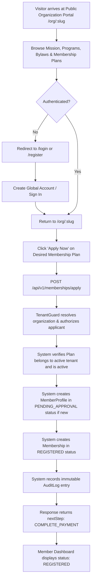

# WAANOFII MEMBER EXPERIENCE SPECIFICATION
## Phase 4: Identity Distinction, Multi-Tenant Affiliations & Application Lifecycle

---

## 1. USER ACCOUNT VS MEMBER PROFILE ARCHITECTURAL DISTINCTION

A core architectural tenet of WaanOfii is that a **User Account** is fundamentally separate from an **Organization Membership**:

```text
┌─────────────────────────────────────────────────────────────┐
│                     Global User Account                     │
│    (id, email, phone, passwordHash, firstName, lastName)    │
└──────────────────────────────┬──────────────────────────────┘
                               │
               ┌───────────────┴───────────────┐
               ▼                               ▼
┌─────────────────────────────┐ ┌─────────────────────────────┐
│ Organization A: 4B Assoc    │ │ Organization B: Ethio-Med   │
│ ├── MemberProfile (MEM-001) │ │ ├── MemberProfile (MEM-042) │
│ ├── Role: MEMBER            │ │ ├── Role: MEMBER            │
│ └── Membership: REGISTERED  │ │ └── Membership: ACTIVE      │
└─────────────────────────────┘ └─────────────────────────────┘
```

1. **Global Identity (`User`):** Represents the person across the SaaS platform. One person registers once with their email or phone number.
2. **Tenant Affiliation (`MemberProfile`):** Represents the person's member record inside a specific organization. A user may have zero, one, or multiple `MemberProfile` records across different organizations.
3. **Staff Roles (`StaffMembership`):** A user may concurrently hold administrative roles (e.g., `ADMIN`, `FINANCE_OFFICER`) in Organization A while being a regular `MEMBER` in Organization B.

---

## 2. MEMBER ONBOARDING & APPLICATION LIFECYCLE



### 2.1 State Representation & Invariants
- When an application is submitted, the initial `MembershipStatus` is strictly **`REGISTERED`**.
- The client cannot mark the membership `ACTIVE`, `APPROVED`, or `PAID`.
- Payment amounts, registration fees, and currency are derived server-side from the verified `MembershipPlan`.

---

## 3. MEMBER DASHBOARD EXPERIENCE (`/app/dashboard`)

The member dashboard provides verified status indicators:
1. **Active Context:** Displays current organization name and member number.
2. **Status Banner:**
   - For `REGISTERED` or `PAYMENT_PENDING`: Displays actionable notice: *"Your application is REGISTERED. Next step: complete payment once processing is enabled."*
   - For `ACTIVE`: Displays verified standing.
3. **Metrics Cards:**
   - Member Number: Unique tenant-scoped identifier (`memberNumber`).
   - Current Plan: Plan name, dues amount, and billing interval.
   - Digital Card: Status indicator (*"Activation Pending"*) explaining that cards are automatically issued upon membership activation.

---

## 4. MEMBER PROFILE MANAGEMENT (`/app/profile`)

### 4.1 Permitted Editable Fields
Members are authorized to inspect and update their own personal information:
- First Name & Last Name
- Email Address & Phone Number
- Residential Address & City/Region
- National ID Number
- Gender & Date of Birth

### 4.2 Protected Server-Controlled Fields (Immutable to Client)
The backend `ValidationPipe` with `forbidNonWhitelisted: true` and PostgreSQL RLS strictly reject client attempts to modify:
- `id` (Record UUID)
- `organizationId` (Tenant boundary)
- `userId` (Owner identifier)
- `memberNumber` (Assigned roster number)
- `status` (`MemberStatus` lifecycle state)
- `joinedAt`, `createdAt`, `updatedAt`, `deletedAt`
Any payload containing these fields returns **HTTP 400 Bad Request**.

---

## 5. MULTI-TENANT CONTEXT SWITCHING (`/app/organizations`)

Users belonging to multiple organizations can change active context via the `OrganizationSwitcher`:
1. `GET /api/v1/me/organizations` queries all verified `MemberProfile` and `StaffMembership` records for the authenticated user.
2. The user selects an organization from the dropdown.
3. `ApiClient.setActiveTenantId(org.id)` stores the active context.
4. Subsequent API calls transmit `x-tenant-id: <org.id>`, establishing the tenant context in NestJS `TenantResolutionMiddleware` and PostgreSQL RLS `withTenantContext`.
5. If a user attempts to forge a tenant header for an organization they do not belong to, `TenantGuard` rejects the request with **HTTP 403 Forbidden**.
