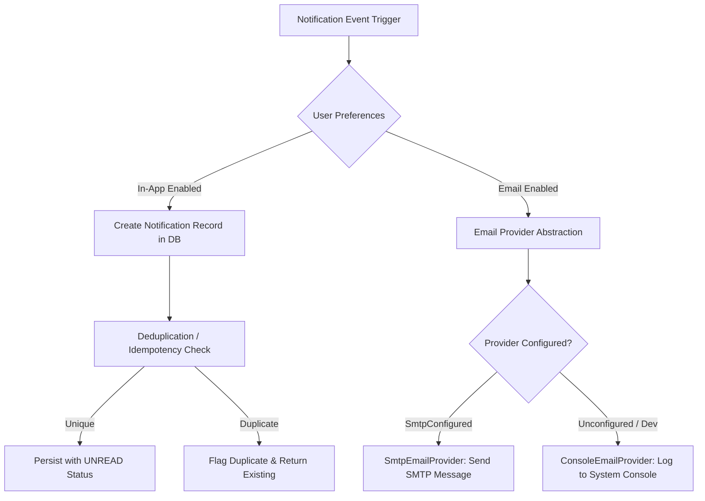

# WaanOfii — Notifications & Dispatch Architecture

## 1. Overview & Purpose

The Notifications subsystem provides multi-channel notification dispatch, in-app notification tracking, user communication preferences, and broadcast messaging across tenants.

---

## 2. Notification Pipeline & Abstraction

### 2.1 Provider Verification Status

| Provider | Mechanism | Status | Notes |
|---|---|---|---|
| **ConsoleEmailProvider** | Local logging to stdout / audit logs | Active / Default | Fully functional in all local and test environments. |
| **SmtpEmailProvider** | Production SMTP via NodeMailer | `UNCONFIGURED (IMPLEMENTED — EXTERNAL VERIFICATION NOT TESTED)` | Requires live SMTP server credentials (`SMTP_HOST`, `SMTP_PORT`, `SMTP_USER`, `SMTP_PASS`). Tested in isolation with mock transport. |

---

## 3. Idempotency & Deduplication

To prevent duplicate notifications arising from network retries, scheduled tasks, or webhook replays:
- Notifications support an optional `idempotencyKey` parameter.
- The `Notification` model enforces uniqueness across `[userId, idempotencyKey]`.
- When an identical key is dispatched, `NotificationsService.sendNotification` catches the collision and returns `{ isDuplicate: true, notification: existingRecord }`.

---

## 4. In-App Notification Lifecycle

1. **Dispatch**: Notification is created with status `UNREAD` and `readAt: null`.
2. **Retrieval**: User queries `GET /api/v1/notifications`, returning notifications and unread counter `unreadCount`.
3. **Mark as Read**: User calls `PATCH /api/v1/notifications/:id/read`, transitioning status to `READ` and populating `readAt: new Date()`.
4. **Mark All Read**: User calls `POST /api/v1/notifications/mark-all-read`, updating all unread notifications for that user and tenant in a single batch transaction.

---

## 5. User Notification Preferences

Every user can configure preferences per tenant via `GET /api/v1/notifications/preferences` and `PATCH /api/v1/notifications/preferences`:
- `emailEnabled`: Flag indicating if external emails should be dispatched.
- `smsEnabled`: Reserved for future SMS provider integration.
- `inAppEnabled`: Controls in-app feed creation.
- `paymentUpdates`: Toggle for financial notifications.
- `membershipUpdates`: Toggle for card and status changes.
- `announcements`: Toggle for broadcast messages.

---

## 6. Tenant-Wide Broadcasts

Tenant administrators with `tenant:communications:send` or `tenant:members:manage` permissions can dispatch notifications to all active members of an organization:
- Endpoint: `POST /api/v1/notifications/broadcast`
- Payload: `title`, `message`, `type`, `targetRole` (optional).
- Execution: Resolves all active members within the organization session, respects individual user preferences, and persists notification records within tenant scope.
- Result: Returns `{ delivered: count, targetAudience: 'ALL_MEMBERS' }`.
