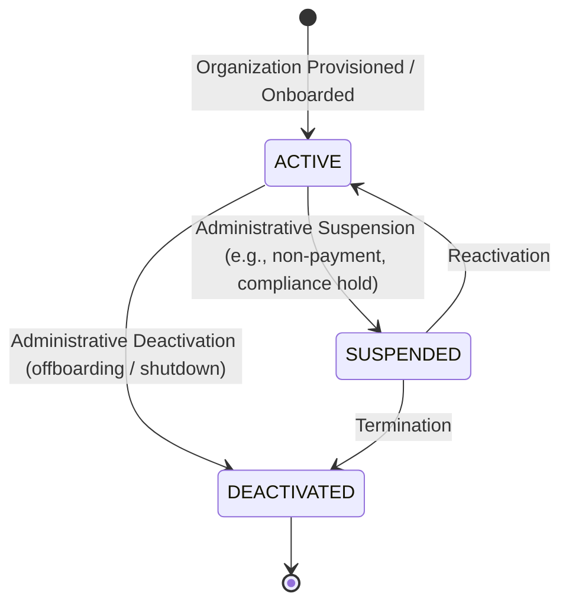

# WaanOfii — Organization Operations & Lifecycle Architecture

## 1. Overview & Purpose

WaanOfii is a multi-tenant Software-as-a-Service (SaaS) platform designed to support numerous independent membership organizations. Organization operations encompass the administrative lifecycle of tenants, configuration updates, and operational status management.

Crucially, **no organization (including 4B Association) is ever hard-coded in production logic**. All organizations are treated generically and governed by the same multi-tenant boundaries.

---

## 2. Organization Lifecycle States

An organization transitions across three distinct operational states:



### 2.1 State Definitions

| Status | Code | Read Access | Mutating Access | Operational Impact |
|---|---|---|---|---|
| **ACTIVE** | `ACTIVE` | Permitted | Permitted | Full standard operational capability. Members can apply, submit payments, verify IDs, and manage settings. |
| **SUSPENDED** | `SUSPENDED` | Permitted | **Blocked (HTTP 403)** | Tenant is placed into read-only quarantine. Existing data remains visible, but all state-modifying actions (`POST`, `PATCH`, `PUT`, `DELETE`) are rejected with `HTTP 403 Forbidden` (`Organization operations are suspended`). |
| **DEACTIVATED** | `DEACTIVATED` | **Blocked (HTTP 403)** | **Blocked (HTTP 403)** | Complete operational lockout. All tenant requests are terminated with `HTTP 403 Forbidden` (`Organization is deactivated`). |

---

## 3. Enforcement Architecture: TenantGuard

Status enforcement occurs at the gateway boundary in `src/tenant/tenant.guard.ts`. When a tenant request is resolved:

```typescript
// Status check
if (org.status === 'SUSPENDED') {
  const method = request.method?.toUpperCase();
  // Allow read methods (GET, HEAD, OPTIONS)
  if (!['GET', 'HEAD', 'OPTIONS'].includes(method)) {
    throw new ForbiddenException(
      'Organization operations are suspended. Contact platform administrator.',
    );
  }
} else if (org.status === 'DEACTIVATED') {
  throw new ForbiddenException('Organization is deactivated.');
}
```

This guarantees that:
1. Operational suspensions are enforced uniformly across all endpoints, modules, and controllers without requiring per-route boilerplate.
2. Even authenticated tenant admins or users cannot bypass operational suspension.
3. Deactivated tenants are completely quarantined.

---

## 4. Platform Administration vs. Tenant Administration

| Dimension | Platform Super Admin | Tenant Admin / Staff |
|---|---|---|
| **Scope** | Cross-tenant global operations | Single-tenant scoped |
| **RBAC Requirement** | Global `SUPER_ADMIN` role | Tenant role with `tenant:settings:manage` or `tenant:members:manage` |
| **Lifecycle Transitions** | Can change status to `ACTIVE`, `SUSPENDED`, or `DEACTIVATED` | **Cannot** alter organization lifecycle status |
| **Settings Modification** | Can inspect and manage global metadata | Can configure organization contact details, settings, and public CMS |
| **Endpoints** | `/api/v1/admin/organizations/**` | `/api/v1/organizations/**`, `/api/v1/cms/**` |

---

## 5. Audit Logging

Every lifecycle transition triggers an immutable audit log row:
- **Action**: `ORGANIZATION_STATUS_UPDATED`
- **Entity**: `Organization`
- **Metadata**: Records `previousStatus`, `newStatus`, `reason`, and `actorUserId`.
- **Tenant Context**: Appropriately scoped to the affected organization.
