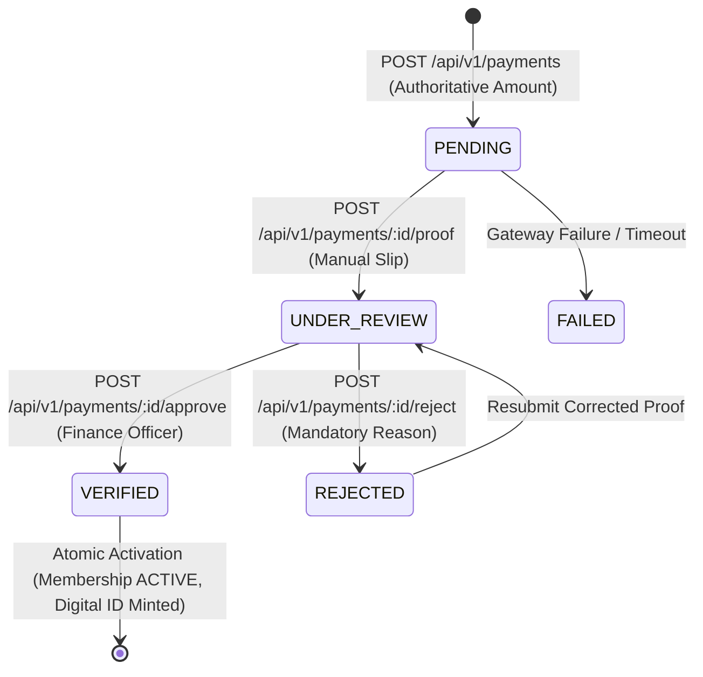

# WaanOfii Architecture — Payments Engine & Abstraction

## 1. Executive Summary

Phase 5 introduces the server-authoritative financial layer into WaanOfii, supporting multi-tenant membership payment processing, manual payment proof verification, automated provider abstraction, and atomic membership activation.

The design strictly follows the **Critical Money Rule**: no monetary calculations are ever performed in JavaScript floating-point arithmetic or dictated by client requests. All amounts, currencies, and fees are server-computed using arbitrary-precision Prisma `Decimal(12, 2)` arithmetic derived from tenant-scoped `membership_plans`.

---

## 2. Payment Lifecycle State Machine

A payment transitions through deterministic states managed by database constraints and row-level security:



### State Definitions
* **`PENDING`**: Payment initiated by the applicant or member. Authoritative amount locked from plan dues and registration fee. Idempotency key recorded.
* **`UNDER_REVIEW`**: Manual bank payment proof uploaded (JPEG, PNG, WebP, or PDF $\le$ 5MB). In queue for finance department inspection.
* **`VERIFIED`**: Validated against bank statements or gateway callback. Membership immediately activated.
* **`REJECTED`**: Insufficient or invalid proof. A mandatory `rejectionReason` is recorded immutably, and the member is prompted to upload a corrected bank slip.
* **`FAILED`**: Gateway or provider-side unrecoverable failure.

---

## 3. Critical Money Rule & Calculations

To avoid floating-point rounding bugs common in SaaS applications, all currency handling complies with the following architecture:

1. **Server-Authoritative Pricing**: Clients never transmit `amount`, `currency`, or `isPaid`.
2. **Arbitrary-Precision Arithmetic**: Calculations use Prisma's `Prisma.Decimal` instances.
3. **Database Constraints**:
   * `check_payment_amount_positive`: Database CHECK constraint ensuring `amount > 0`.
   * Precision: `Decimal(12, 2)` storing values up to 9,999,999,999.99 with exact 2-decimal precision.
4. **Transparent Fee Breakdown**: Responses explicitly distinguish `planPrice`, `registrationFee`, and `totalAmount`.

---

## 4. Provider Abstraction Architecture

Payments interface with disparate financial rails (local banks, mobile money, and gateways) through a unified polymorphic adapter pattern:

```text
src/payments/providers/
├── payment-provider.interface.ts  # Unified IPaymentProvider interface
├── payment-provider.registry.ts   # Dynamic provider locator
├── manual-bank.provider.ts        # Manual bank deposit & slip submission
├── telebirr.provider.ts           # Telebirr SuperApp / USSD integration
├── cbe-birr.provider.ts           # Commercial Bank of Ethiopia mobile money
└── chapa.provider.ts              # Chapa international/local card gateway
```

### Provider Interface
Every adapter implements `IPaymentProvider`:
```typescript
export interface IPaymentProvider {
  readonly providerType: PaymentProvider;
  initiatePayment(params: PaymentInitiationParams): Promise<PaymentInitiationResult>;
  verifyPayment?(params: PaymentVerificationParams): Promise<PaymentVerificationResult>;
  processWebhook?(payload: Record<string, any>, signature?: string): Promise<WebhookProcessingResult>;
}
```

* **Offline / Manual Fallback**: Organizations without gateway accounts default to `MANUAL_BANK`, which provides localized bank deposit instructions and bank account details.
* **Extensible Gateway Integration**: Direct gateways (`TELEBIRR`, `CBE_BIRR`, `CHAPA`) generate checkout URLs or USSD push payloads without altering the underlying payments service.

---

## 5. Manual Payment Proof Submission & Validation

When using `MANUAL_BANK`, members upload deposit receipts adhering to strict security policies:

1. **File Type Whitelist**: Strictly restricted to `image/jpeg`, `image/png`, `image/webp`, and `application/pdf`. Executables, SVG, and HTML are rejected.
2. **File Size Limit**: Hard enforced at minimum 1 KB and maximum 5,242,880 bytes (5 MB).
3. **Proof Anti-Reuse Uniqueness**: The database enforces `UNIQUE (organization_id, file_url)` to prevent fraudulent replay of identical slips.
4. **Isolated Path Storage**: Slips are stored in tenant-isolated paths under `/proofs/{orgId}/{year}/{ref}.ext`.

---

## 6. Finance Review & Segregation of Duties

The finance workflow enforces enterprise governance:

* **Role-Based Review Queue**: Only users possessing `tenant:finance:manage` or `tenant:payments:review` permissions can view `/api/v1/payments/review`.
* **Segregation of Duties (SoD)**: A user cannot approve or reject their own payment proof under any circumstances. If `payment.memberProfile.userId === reviewerUserId`, the system throws `ForbiddenException(403)`:
  ```typescript
  if (payment.memberProfile.userId === reviewerUserId) {
    throw new ForbiddenException(
      'Segregation of duties violation: You cannot approve or review your own payment proof.',
    );
  }
  ```
* **Mandatory Rejection Rationale**: Rejections require a human-readable reason recorded in `payment_reviews` and dispatched to the applicant.

---

## 7. Atomic Membership Activation

Upon successful payment verification, an atomic database transaction (`tx`) executes:
1. `payments`: Status updated to `VERIFIED`, `verifiedAt = now()`.
2. `payment_reviews`: Audit record created with reviewer ID, decision, and notes.
3. `memberships`: Status transitioned to `ACTIVE`.
4. `member_profiles`: Status transitioned to `ACTIVE` (if not already active).
5. `membership_periods`: Created with UTC start and end dates derived from billing interval (e.g., 1 year).
6. `digital_membership_cards`: Issued with unique card number, version 1, and status `ACTIVE`.
7. `verification_tokens`: Minted with 256-bit cryptographically secure token.
8. `audit_logs`: Immutable audit entry appended with actor user ID and tenant context.

If any operation fails, the transaction rolls back completely, ensuring zero half-activated states.
