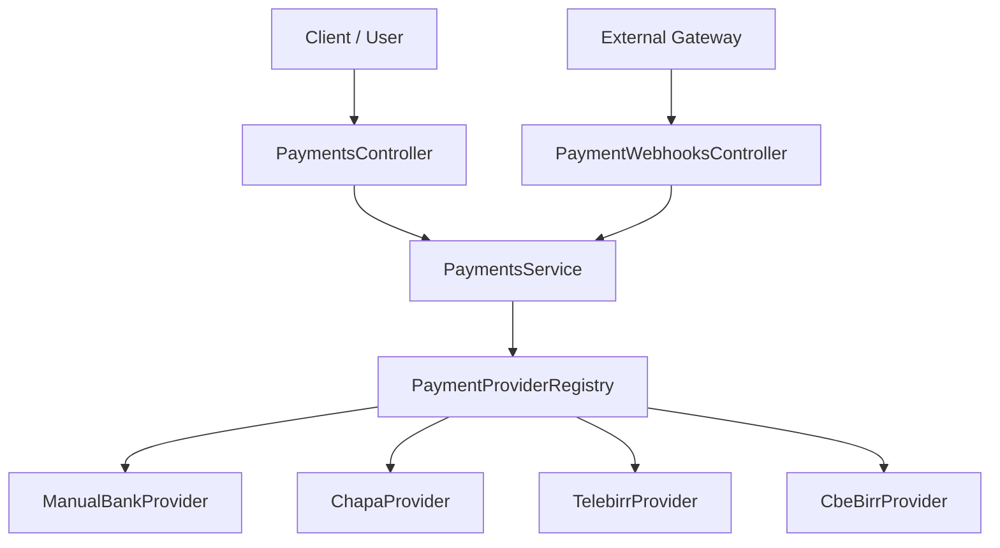

# WaanOfii Architecture — Payment Provider Subsystem

## 1. Overview & Provider Registry Pattern

WaanOfii supports multiple electronic payment gateways alongside manual bank transfer workflows within a multi-tenant SaaS architecture. To decouple external payment gateway SDKs and vendor-specific APIs from core SaaS business logic, the platform employs the **Provider Adapter & Registry Pattern**.

The registry decouples the rest of the application through a standardized TypeScript interface (`IPaymentProvider`), ensuring uniform execution semantics, status normalization, retry strategies, and error classifications.



## 2. Standardized Provider Contract (`IPaymentProvider`)

Every payment gateway adapter implements the `IPaymentProvider` interface (`src/payments/providers/payment-provider.interface.ts`):

```typescript
export interface IPaymentProvider {
  readonly providerType: PaymentProvider;
  readonly isConfigured: boolean;

  initiatePayment(params: PaymentInitiationParams): Promise<PaymentInitiationResult>;
  verifyTransaction(providerTxId: string, expectedReference?: string): Promise<PaymentVerificationResult>;
  queryPaymentStatus?(providerTxId: string): Promise<PaymentVerificationResult>;
  handleWebhook(payload: any, signature?: string, rawBody?: Buffer | string): Promise<WebhookProcessingResult>;
  refundPayment?(paymentId: string, amount: number, reason: string): Promise<boolean>;
}
```

### Registered Providers & Credential State

| Provider Type | Adapter Class | Protocol / Mechanism | Credential Dependency | Default State |
|---|---|---|---|---|
| `MANUAL_BANK` | `ManualBankProvider` | Bank deposit slip / transaction code with finance review | None (Server internal) | `isConfigured: true` |
| `CHAPA` | `ChapaProvider` | Hosted Checkout API, REST verify, HMAC-SHA256 webhooks | `CHAPA_SECRET_KEY`, `CHAPA_PUBLIC_KEY` | `IMPLEMENTED — EXTERNAL VERIFICATION NOT TESTED` |
| `TELEBIRR` | `TelebirrProvider` | RSA-SHA256 signed order API, notify callbacks | `TELEBIRR_APP_ID`, `TELEBIRR_PRIVATE_KEY` | `IMPLEMENTED — EXTERNAL VERIFICATION NOT TESTED` |
| `CBE_BIRR` | `CbeBirrProvider` | CBE Merchant API, FT reference code validation | `CBE_MERCHANT_CODE`, `CBE_API_KEY` | `IMPLEMENTED — EXTERNAL VERIFICATION NOT TESTED` |

> [!NOTE]
> When external payment providers lack live production/sandbox credentials in the execution environment, their transaction verification methods return status `UNVERIFIED_NO_CREDENTIALS` and `isPaid: false`. No fake or fabricated credentials are ever used.

## 3. Resilient Error Hierarchy

To prevent opaque HTTP errors and facilitate automated recovery, WaanOfii implements a structured exception hierarchy rooted in `PaymentProviderException` (`src/payments/providers/common/provider-errors.ts`):

```
PaymentProviderException (base)
 ├── ProviderTimeoutException (HTTP 504, retryable: true)
 ├── ProviderNetworkException (HTTP 503, retryable: true)
 ├── ProviderAuthenticationException (HTTP 401, retryable: false)
 ├── ProviderValidationException (HTTP 400, retryable: false)
 ├── ProviderSignatureException (HTTP 401, retryable: false)
 ├── ProviderAmountMismatchException (HTTP 400, retryable: false)
 └── ProviderCurrencyMismatchException (HTTP 400, retryable: false)
```

## 4. Bounded Retries with Exponential Backoff and Jitter

External HTTP calls to payment gateways are wrapped using `executeWithRetry` (`src/payments/providers/common/retry.util.ts`).
- **Transient Failures Retried**: Abort timeouts (`ETIMEDOUT`, `AbortError`), network disconnects (`ECONNRESET`, `ENOTFOUND`), and HTTP 502/503/504 gateway errors.
- **Fail-Fast on Security & Logic Faults**: Signature failures (`ProviderSignatureException`), validation errors, amount tampering, and authentication errors fail immediately without retries.
- **Backoff Formula**: `delay = min(maxDelayMs, initialDelayMs * backoffFactor^(attempt - 1)) + jitter`.
