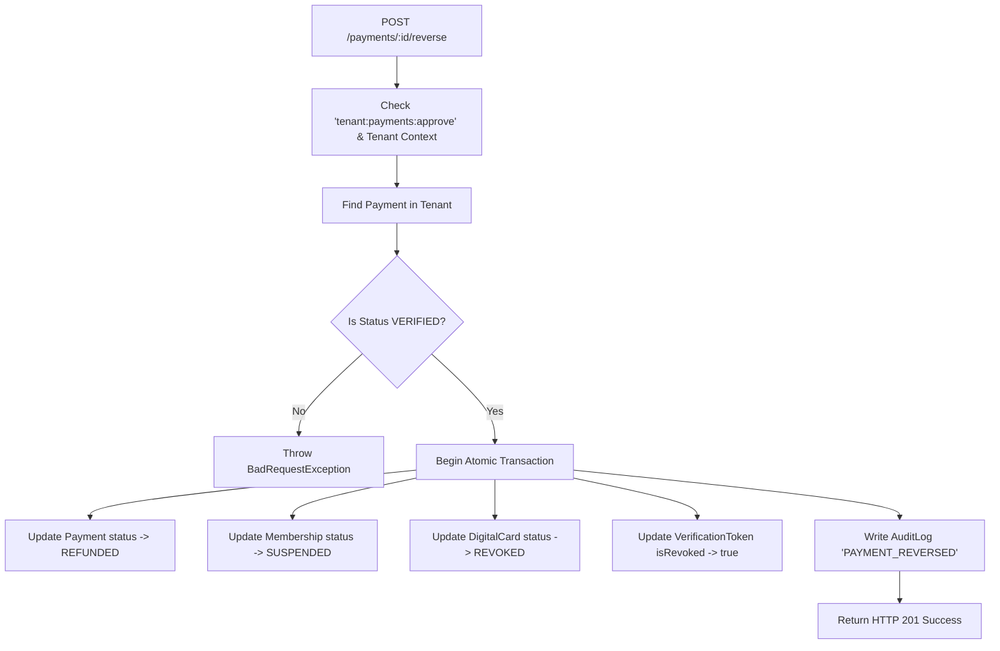

# WaanOfii Architecture — Payment Reconciliation & Reversal Engine

## 1. Overview

In production financial operations, network disruptions, dropped callbacks, or external gateway timeouts can cause discrepancies between provider ledgers and internal platform status. The **Payment Reconciliation Service** and **Payment Reversal Engine** resolve these operational conditions while upholding PostgreSQL Row-Level Security, audit trails, and strict role authorization.

## 2. Reconciliation Engine (`PaymentReconciliationService`)

Mounted under `/api/v1/payments`:
- `POST /api/v1/payments/:id/reconcile`: Reconciles a single payment record against external provider records.
- `POST /api/v1/payments/reconcile/batch`: Scans all pending/under-review payments within the resolved tenant and reconciles them.

Both endpoints require authentication and `tenant:payments:approve` permission (Finance Officer, Admin, or Owner).

### Discrepancy Resolution Matrix

| Scenario | Local Status | Provider Status | Discrepancy Classification | Action Taken |
|---|---|---|---|---|
| Dropped webhook | `PENDING` / `UNDER_REVIEW` | `SUCCESS` / `isPaid: true` | `PENDING_RESOLVED_SUCCESS` | Automatically activates payment to `VERIFIED`, transitions membership to `ACTIVE`, creates `MembershipPeriod`, issues digital card with SHA-256 token. |
| Amount discrepancy | `PENDING` | `SUCCESS` (mismatched amount) | `AMOUNT_MISMATCH` | Flags discrepancy in audit log, refuses automatic activation. |
| Currency discrepancy | `PENDING` | `SUCCESS` (mismatched currency) | `CURRENCY_MISMATCH` | Flags discrepancy in audit log, refuses automatic activation. |
| In-flight / unconfirmed | `PENDING` | `PENDING` | `NONE` | No mutation; records remain synchronized in pending state. |
| Post-verification reversal | `VERIFIED` | `FAILED` / `REFUNDED` | `VERIFIED_FLAGGED_FAILED` | Flags discrepancy in audit log for finance staff investigation. |

All reconciliation actions write an immutable record to `audit_logs` (`action: 'PAYMENT_RECONCILED'`).

## 3. Payment Reversal & Refund Lifecycle

When an authorized finance officer processes a refund or cancels a payment:
`POST /api/v1/payments/:id/reverse`

Requires:
- Header: `x-tenant-id`
- Bearer JWT of user with `tenant:payments:approve` permission
- Body: `{ reason: string }` (mandatory non-empty reason)

### Atomic Reversal Cascade (`PaymentsService.reversePayment`)

Executed inside `prisma.withTenantContext(organizationId, ...)`:

### Verification Invalidation

Once a payment is reversed:
1. Scanning the digital membership card QR code via `GET /api/v1/verify/:token` immediately returns:
   - `isValid: false`
   - `result: "REVOKED"`
   - `message: "This digital membership card has been revoked."`
2. The member is barred from accessing membership privileges until renewed or re-approved.
