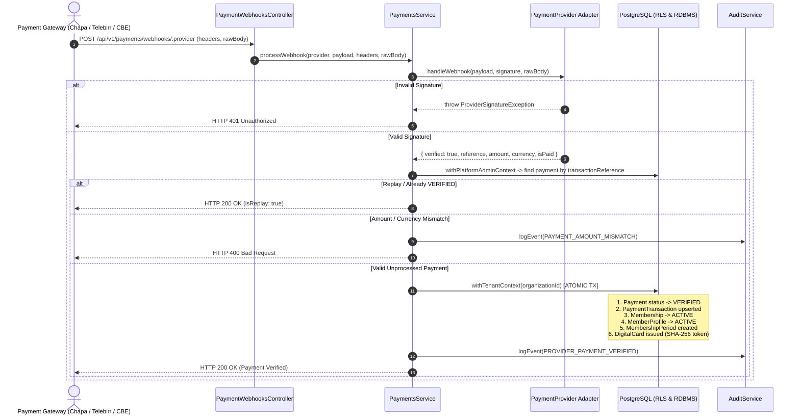

# WaanOfii Architecture — Payment Webhook Ingress & Financial Security

## 1. Webhook Ingress Architecture

WaanOfii exposes a dedicated, unauthenticated public webhook receiver:
`POST /api/v1/payments/webhooks/:provider`

This controller is decorated with `@Public()` to bypass JWT guards, while enforcing cryptographic authenticity via provider-specific signatures before processing any internal state changes.



## 2. Cryptographic Signature Schemes

Each provider implements vendor-specific cryptographic signature verification:

1. **Chapa**:
   - Signature header: `x-chapa-signature`
   - Scheme: HMAC-SHA256 of the raw request body using `payments.chapa.webhookSecret` (or secretKey).
   - Tampered payload or mismatch throws `ProviderSignatureException('CHAPA')`.
2. **Telebirr**:
   - Signature header: `x-telebirr-signature` or payload field `sign`.
   - Scheme: Asymmetric RSA-SHA256 verification against `payments.telebirr.publicKey` (with HMAC-SHA256 fallback if symmetric `appKey` configured).
3. **CBE Birr**:
   - Signature header: `x-cbe-signature` or payload field `signature`.
   - Scheme: HMAC-SHA256 signature verification with `payments.cbeBirr.secretKey`.

## 3. Financial Anti-Tampering & Anti-Fraud Controls

1. **Amount Verification (Money Rule)**:
   - When a webhook reports `amount`, it is converted to `Prisma.Decimal` and compared strictly to `payment.amount`:
     ```typescript
     if (!webhookAmount.equals(payment.amount)) {
       throw new BadRequestException('Payment amount mismatch between provider and order');
     }
     ```
   - Tampered amounts are rejected with HTTP 400 and logged to the audit trail as `PAYMENT_AMOUNT_MISMATCH`.
2. **Currency Verification**:
   - Webhook `currency` must strictly match the internal order currency (e.g. `ETB`). Mismatches are rejected.
3. **Replay Protection & Idempotent Deduplication**:
   - If a duplicate webhook notification arrives for an order that is already in `VERIFIED` status, the service halts further processing and immediately returns `{ success: true, isReplay: true }`.
   - This prevents double-activation of memberships, double issuance of cards, or corrupted accounting states.
4. **Tenant Boundary Protection**:
   - The payment is looked up globally by unique transaction reference, and the subsequent activation transaction executes strictly inside `withTenantContext(payment.organizationId)`.
