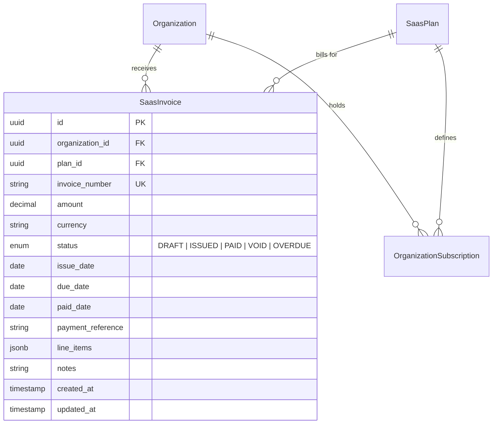
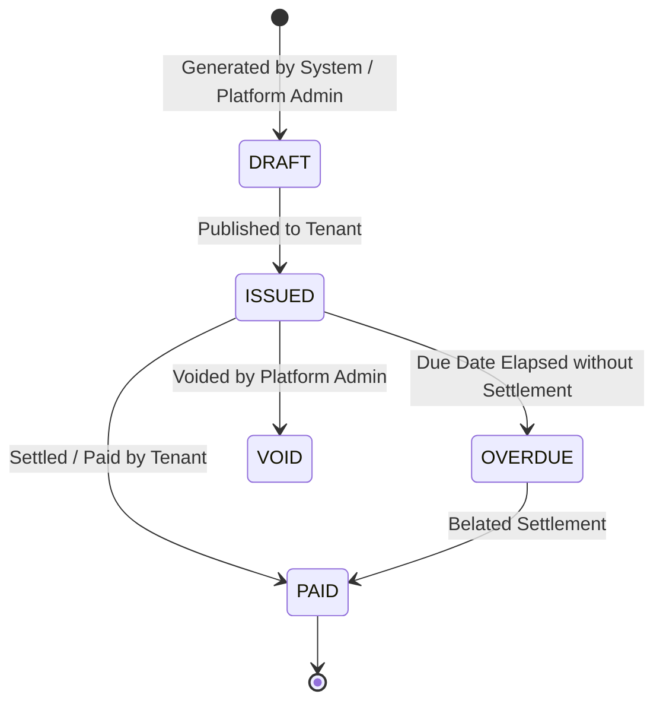

# WaanOfii — SaaS Billing & Invoice Management Architecture

## 1. Overview & Purpose

WaanOfii operates as a commercial B2B multi-tenant SaaS platform. Tenant organizations subscribe to SaaS plans and receive platform invoices for platform service charges, tiered seat capacity, and premium add-ons.

---

## 2. Relational Model & Database Schema

The SaaS billing architecture introduces two primary models:



### 2.1 Schema Details
- **`organization_id`**: Scopes each invoice to the tenant organization. Protected by PostgreSQL Row-Level Security (`ALTER TABLE saas_invoices FORCE ROW LEVEL SECURITY`).
- **`invoice_number`**: Globally unique, formatted sequence identifier (e.g., `INV-2026-000001`).
- **`amount`**: Exact monetary representation (`Decimal(12, 2)` with check constraint `amount > 0`).
- **`status`**: State machine (`DRAFT`, `ISSUED`, `PAID`, `VOID`, `OVERDUE`).
- **`line_items`**: Structured JSON array describing invoiced services, unit quantities, and taxes.

---

## 3. Invoice Lifecycle & Permissions



### 3.1 Strict Segregation of Duties

| Operation | Platform Super Admin | Tenant Admin / Staff | Member |
|---|---|---|---|
| **Create SaaS Invoice** | Permitted | **Blocked (HTTP 403)** | **Blocked (HTTP 403)** |
| **List All Invoices (All Tenants)** | Permitted | **Blocked (HTTP 403)** | **Blocked (HTTP 403)** |
| **List Tenant Invoices (Own Org)** | Permitted | Permitted | **Blocked (HTTP 403)** |
| **Settle / Pay SaaS Invoice** | Permitted | Permitted (Simulated Gateway) | **Blocked (HTTP 403)** |
| **Void SaaS Invoice** | Permitted | **Blocked (HTTP 403)** | **Blocked (HTTP 403)** |

---

## 4. Tenant Isolation & PostgreSQL RLS

Invoices contain sensitive financial information regarding platform licensing. PostgreSQL Row-Level Security ensures that tenant isolation is guaranteed even in the event of an application logic bug:

```sql
ALTER TABLE saas_invoices ENABLE ROW LEVEL SECURITY;
ALTER TABLE saas_invoices FORCE ROW LEVEL SECURITY;

CREATE POLICY tenant_isolation_saas_invoices ON saas_invoices
    FOR ALL
    USING (
        current_setting('app.current_organization_id', true) IS NOT NULL
        AND organization_id = NULLIF(current_setting('app.current_organization_id', true), '')::uuid
    );
```

When an Ethio-Med administrator attempts to query an invoice belonging to 4B Association, PostgreSQL filters out the record directly in the storage engine, returning zero rows.
