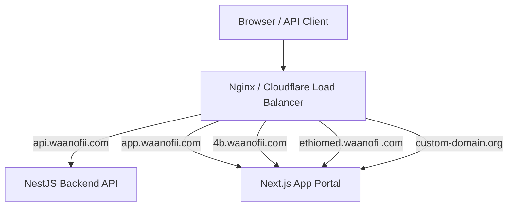

# WaanOfii — Production Deployment Guide

## 1. System Components

A full production deployment of WaanOfii consists of:
1. **NestJS Backend API**: Node.js 20+ runtime listening on port 3000 (configurable via `PORT`).
2. **Next.js Web Frontend**: Node.js or edge runtime listening on port 3001.
3. **PostgreSQL 17 Database**: Primary relational store with Row-Level Security enabled.
4. **Reverse Proxy / Load Balancer**: Nginx, Caddy, AWS ALB, or Cloudflare handling TLS termination, subdomain routing, and HTTP/2 proxying.
5. **Object Storage**: S3-compatible bucket (AWS S3, MinIO, Cloudflare R2) for payment proof documents and profile images.

---

## 2. Multi-Tenant Subdomain Routing Architecture

WaanOfii dynamically resolves tenants based on incoming requests:



### 2.1 Resolution Precedence (TenantResolutionService)
1. Header `x-tenant-id` (explicit UUID)
2. Header `x-tenant-slug` (e.g., `4b`, `ethio-med`)
3. Subdomain extraction: Host `4b.waanofii.com` resolves slug `4b` (ignoring reserved subdomains: `api`, `app`, `admin`, `www`, `mail`).
4. Custom domain lookup: Matches registered `organization_domains` in database.
5. Route parameter `:slug` or `:organizationId`.

---

## 3. Deployment Steps

### Step 1: Database Setup
1. Provision PostgreSQL 17 database instance.
2. Create application runtime user with strict security flags:
   ```sql
   CREATE ROLE waanofii_app LOGIN PASSWORD '<STRONG_PASSWORD>' NOINHERIT NOBYPASSRLS;
   CREATE ROLE waanofii_platform_admin NOINHERIT NOBYPASSRLS;
   REVOKE waanofii_platform_admin FROM waanofii_app;
   ```
3. Run migrations and apply RLS policies:
   ```bash
   npx prisma migrate deploy
   psql -U postgres -d waanofii_db -f prisma/rls_policies.sql
   ```

### Step 2: Backend API Deployment
1. Set environment variables (see `ENVIRONMENT_CONFIGURATION.md`).
2. Build backend:
   ```bash
   npm run build
   ```
3. Run production process using process manager (e.g., PM2 or Docker container):
   ```bash
   node dist/src/main.js
   ```
4. Verify readiness:
   ```bash
   curl -f http://localhost:3000/api/v1/health/ready
   ```

### Step 3: Frontend Deployment
1. Set `NEXT_PUBLIC_API_URL=https://api.waanofii.com/api/v1`.
2. Build Next.js web application:
   ```bash
   npm run build:web
   ```
3. Launch frontend server:
   ```bash
   npm run start --workspace=apps/web
   ```

---

## 4. Reverse Proxy (Nginx Example)

```nginx
server {
    listen 443 ssl http2;
    server_name api.waanofii.com;

    ssl_certificate /etc/letsencrypt/live/api.waanofii.com/fullchain.pem;
    ssl_certificate_key /etc/letsencrypt/live/api.waanofii.com/privkey.pem;

    location / {
        proxy_pass http://127.0.0.1:3000;
        proxy_http_version 1.1;
        proxy_set_header Upgrade $http_upgrade;
        proxy_set_header Connection 'upgrade';
        proxy_set_header Host $host;
        proxy_set_header X-Real-IP $remote_addr;
        proxy_set_header X-Forwarded-For $proxy_add_x_forwarded_for;
        proxy_set_header X-Forwarded-Proto $scheme;
    }
}
```
