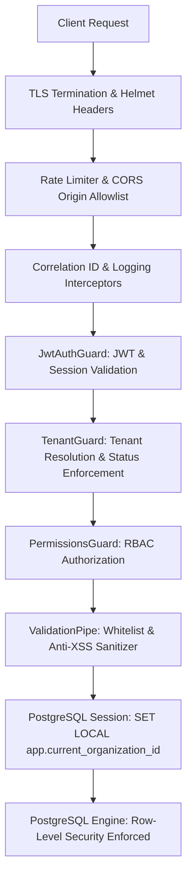

# WaanOfii — Security Operations, Hardening & Threat Model

## 1. Multi-Layered Defense Model

---

## 2. Security Subsystems & Controls

### 2.1 Password Hashing & Authentication
- Passwords are encrypted using **Argon2id** (memory cost 65536 KiB, time cost 3 iterations, parallelism 4).
- Password hashes are marked `@map("password_hash")` and explicitly excluded from Prisma `select` schemas returned to clients.
- Authentication tokens are delivered via `HttpOnly`, `SameSite: Lax`, `Secure` cookies.

### 2.2 PostgreSQL Row-Level Security (RLS)
- Enforced on all 26 tenant-scoped tables.
- The connection role `waanofii_app` is `NOBYPASSRLS` and has `CREATE` revoked on `public`.
- Cross-tenant queries are blocked directly in the PostgreSQL execution planner.

### 2.3 Cross-Site Scripting (XSS) Prevention
- Anti-XSS engine (`sanitizeContentValue`) rejects `<script>`, event handlers (`onerror`, `onload`, `onclick`), `javascript:` URIs, and `<iframe` with `HTTP 400 Bad Request`.
- React and Next.js JSX rendering automatically escapes dynamic values.

### 2.4 Server-Side Request Forgery (SSRF) & Upload Validation
- Payment proof URLs validated via `validateProofUrl`:
  - Rejects loopback addresses (`127.0.0.1`, `localhost`).
  - Rejects cloud instance metadata endpoints (`169.254.169.254`).
  - Rejects RFC 1918 private subnets (`10.0.0.0/8`, `172.16.0.0/12`, `192.168.0.0/16`).
  - Rejects path traversal sequences (`../`, `%2e%2e`, null bytes).
  - Validates binary magic bytes for uploaded assets (JPEG, PNG, PDF).

### 2.5 Digital Membership QR Security
- Verification tokens are 256-bit cryptographically secure random values.
- Lookups in `CardsService.verifyToken` use SHA-256 hashes only (`findUnique({ where: { tokenHash } })`).
- Verification responses strictly omit private personal data (email, phone, national ID) for minimal disclosure.
